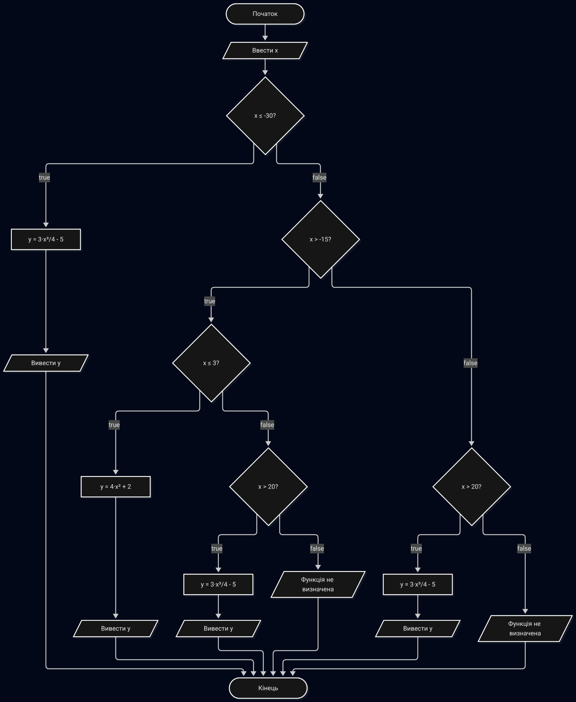
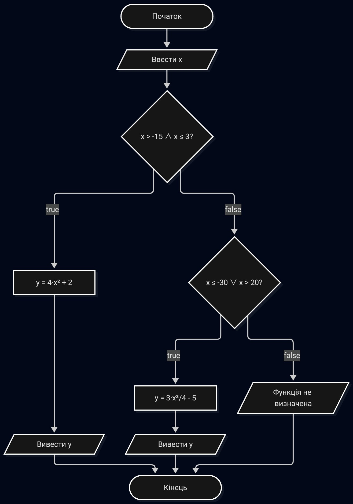
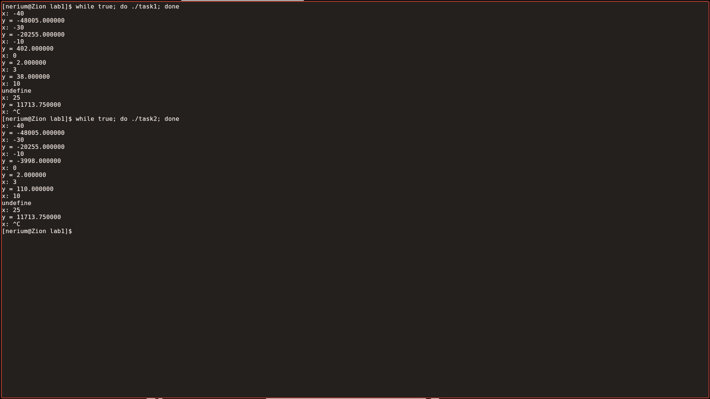

# Лабораторна робота № 1
## Розгалужені алгоритми

**Дисципліна:** Структури даних та алгоритми (СДА)  
**Мова програмування:** С  

**Виконав:**  
студент групи ІО-63  
Тунік Гліб Олександрович  
Номер у списку групи: 24  

**Перевірив:**  
Русінов Володимир Володимирович  

Київ — 2026

---

## 1. Мета лабораторної роботи

Метою лабораторної роботи «Розгалужені алгоритми» є засвоєння теоретичного матеріалу та набуття практичних навичок використання керуючих конструкцій розгалуження та булевих (логічних) операцій.

---

## 2. Постановка задачі

Задано дійсне число \( x \). Визначити значення заданої за варіантом кусково-неперервної функції \( y(x) \), якщо воно існує, або вивести на екран повідомлення про неіснування функції для заданого \( x \).

Розв’язати задачу **двома способами**:

1. У програмі дозволяється використовувати тільки одиничні операції порівняння і **не дозволяється** використовувати булеві (логічні) операції.
2. У програмі необхідно **обов’язково** використати булеві (логічні) операції; використання булевих операцій не повинно бути надлишковим.

**Варіант 24:**

$$
y(x) =
\begin{cases}
4x^{2} + 2, & x \in (-15;\ 3] \\[6pt]
\dfrac{3x^{3}}{4} - 5, & x \in (-\infty;\ -30] \cup (20;\ +\infty)
\end{cases}
$$

---

## 3. Блок-схеми алгоритмів

### Блок-схема 1



### Блок-схема 2



---

## 4. Текст програм

### Програма 1 (без логічних операцій)

```c
#include<stdio.h>


int main () {
  double x;
  double y;
  int def = 0;

  printf("x: ");
  scanf("%lf", &x);

if(x <= -30.0) {
  y = 3.0 * x * x * x / 4.0 - 5.0;
  def = 1;
} else if(x > -15.0) {
  if (x <= 3.0) {
    y = 4.0 * x * x + 2.0;
    def = 1;
  } else if (x > 20.0) {
    y = 3.0 * x * x * x / 4.0 - 5.0;
    def = 1;
  } 
} else if (x > 20.0) {
  y = 3.0 * x * x * x / 4.0 - 5.0;
  def = 1;
}

if(def) {
  printf("y = %lf\n", y);
} else {
  printf("undefine\n");
}

  return 0;
}
```

### Програма 2

```c
#include<stdio.h>


int main () {
  double x;
  double y;

  printf("x: ");
  scanf("%lf", &x);

  if(x > -15.0 && x <= 3.0) {
    y = 4.0 * x * x * x + 2.0;
    printf("y = %lf\n", y);
  } else if(x <= -30.0 || x > 20.0) {
    y = 3.0 * x * x * x / 4.0 - 5.0;
    printf("y = %lf\n", y);
  } else {
    printf("undefine\n");
  }
  return 0;
}
```
---

## 5. Результати тестування

### Скріншоти тестування програм

 

Виконано успішно.

---

## 6. Висновки

Під час виконання лабораторної роботи було закріплено навички побудови розгалужених алгоритмів та їх реалізації мовою С двома способами: без логічних операцій та з їх використанням. Обидві програми працюють коректно, усі гілки алгоритмів перевірено. Завдання виконано в повному обсязі.


