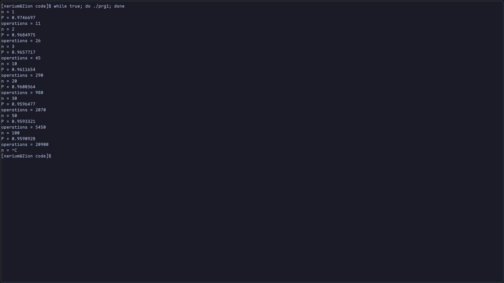
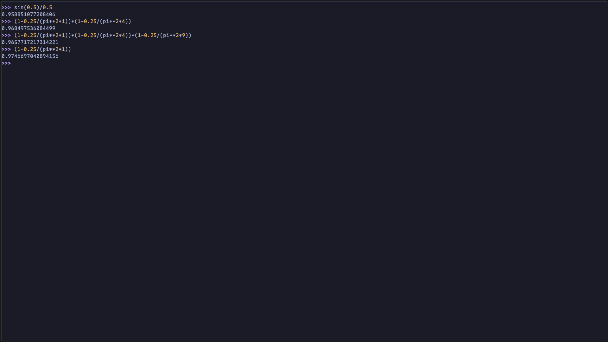
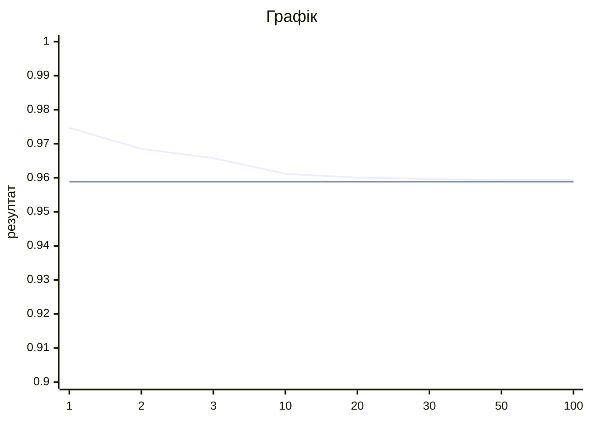

# Лабораторна робота № 2
## Алгоритми з вкладеними циклами та метод динамічного програмування

**Дисципліна:** Структури даних та алгоритми (СДА)  
**Мова програмування:** С  

**Виконав:**  
студент групи ІО-63  
Тунік Гліб Олександрович  
Номер у списку групи: 24  

**Перевірив:**  
Русінов Володимир Володимирович  

Київ — 2026

---

## Мета лабораторної роботи


Засвоєння теоретичного матеріалу та набуття практичних навичок використання різних циклічних керуючих конструкцій, вкладених циклів, методу динамічного програмування та обчислення кількості операцій алгоритмів.

---

## Постановка задачі

1. Задане натуральне число n. Обчислити значення заданої за варіантом формули (ряду або добутку, що наближено обчислює значення певної функції у заданій точці; точність наближення залежить від кількості ітерацій n).
2. Для розв'язання задачі написати **дві програми**:
   1. перша програма обчислює формулу за допомогою **вкладених циклів**;
   2. друга програма обчислює ту саму формулу за допомогою **одного циклу** з використанням **методу динамічного програмування** (тобто накопичуючи черговий доданок/множник на основі попереднього, без повторного обчислення статечних, факторіальних і подібних виразів «з нуля» на кожній ітерації).
3. Виконати розрахунок кількості операцій для кожного з алгоритмів за методикою, викладеною на лекції, додавши до неї підрахунок кількості викликів стандартних функцій.
4. Програма має правильно розв'язувати задачу при будь-якому заданому n, для якого результат обчислення коректно представляється типом `double`.
5. Результат виводити у форматі із **сімома знаками після коми**.

**Умова, варіант 24:**

$$
P=\frac{\sin x}{x}
=\prod_{i=1}^{n}
\left(
1-\frac{x^{2}}{\pi^{2}\sum_{j=1}^{i}(2i-1)}
\right),
\quad x=0.5
$$

##  Текст програм

### Програма 1 

```c
#include<stdio.h>
#include<math.h>


int main () {
  int n;
  int ops = 0;
  
  printf("n = ");
  scanf("%d", &n);
  
  double x = 0.5;
  double P = 1.0;
  double s;
  
  for(int i = 1; i <= n; ++i) {
    s = 0.0;
    for(int j = 1; j <= i; ++j) {
      s += 2 * j - 1;
      ops += 4;
    }
    P *= (1.0 - ((x * x) / (M_PI * M_PI * s)));
    ops += 7;
  }
  
  printf("P = %.7f\n", P);
  printf("operations = %d\n", ops);
  
  return 0;
}
```

### Програма 2

```c
#include<stdio.h>
#include<math.h>


int main () {
  int n;
  int ops = 0;

  printf("n = ");
  scanf("%d", &n);
  
  double P = 1.0;
  double x = 0.5;
  double s = 0.0;
  
  for(int i = 1; i <= n; ++i) {
    s += 2.0 * i - 1;
    P *= 1.0 - ((x * x) / (M_PI * M_PI * s));
    ops += 11;
  }

  printf("P = %.7f\n", P);
  printf("operations = %d\n", ops);

  return 0;
}
```

---

##  Результати тестування

### Скріншоти тестування програм

 
 
 

### Таблиця з результатами запуску програм

| n | 1 | 2 | 3 | 10 | 20 | 30 | 50 | 100 |
|---|---|---|---|---|---|---|---|---|
|спосіб 1 (вкладені цикли) |11|26|45|290|980|2070|5450|20900|
|спосіб 2 (динамічне програмування) |11|22|33|110|220|330|550|1100|

### Графік 

```mermaid
xychart-beta
    title "Графік"
    x-axis [1, 2, 3, 10, 20, 30, 50, 100]
    y-axis "Кількість операцій" 0 --> 25000
    bar [11,26,45,290,980,2070,5450,20900]
    bar [11,22,33,110,220,330,550,1100]
```



### Результати перевірки правильності обчислень




---

## Висновки

Динамічне програмування дозволило значно оптимізувати роботу програми


