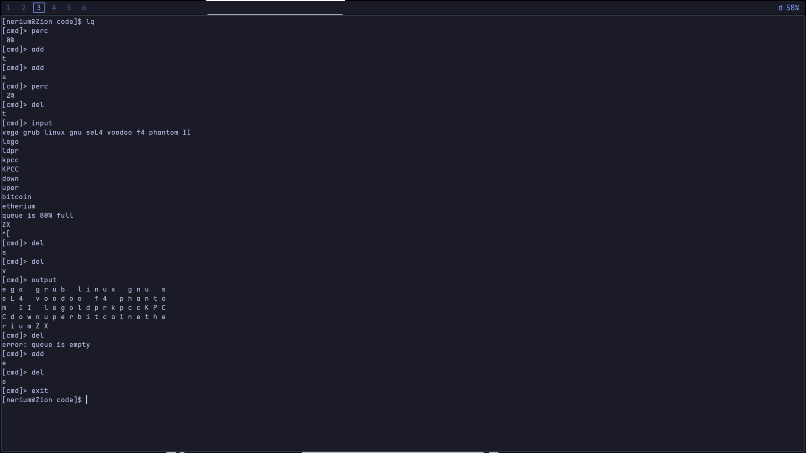
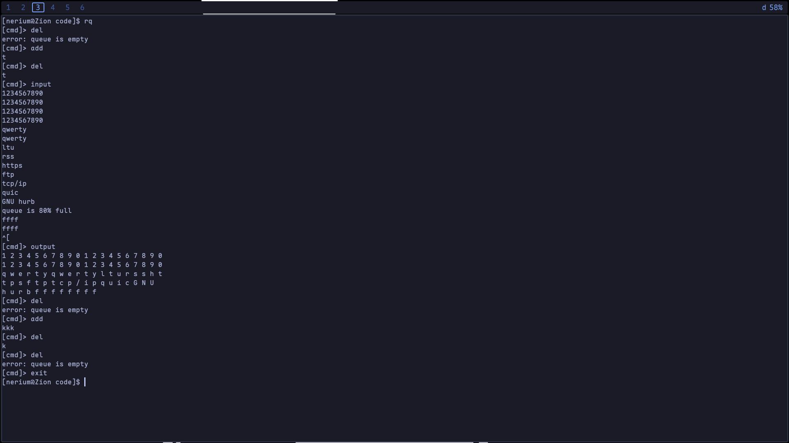
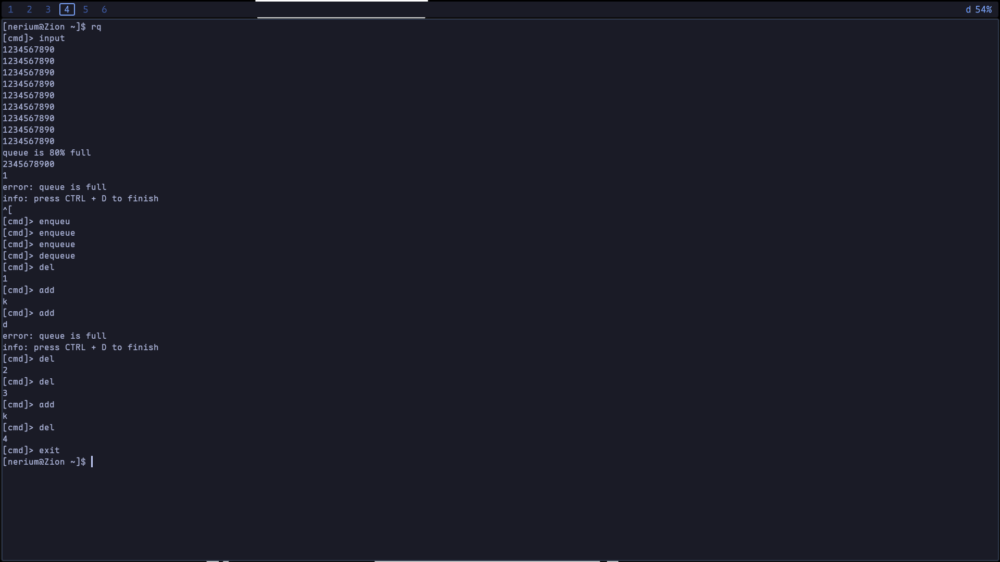

# Лабораторна робота № 3
## Стеки та черги

**Дисципліна:** Структури даних та алгоритми (СДА)  
**Мова програмування:** С (C23) 

**Виконав:**  
студент групи ІО-63  
Тунік Гліб Олександрович  
Номер у списку групи: 24  

**Перевірив:**  
Русінов Володимир Володимирович  

Київ — 2026

***

1. Кожен варіант завдання визначає прикладну задачу (наприклад, перевірку збалансованості дужок, обчислення постфіксного виразу тощо) та структуру(и) даних, потрібну для її розв'язання (стек, чергу, або обидві).
2. Для розв'язання задачі написати **дві програми**, що реалізують ту саму структуру даних двома способами:
   1. на основі **одновимірного масиву фіксованого розміру** (з окремими змінними/індексами для вершини стека або голови й хвоста черги);
   2. на основі **однозв'язного списку** (динамічне виділення пам'яті: вузол зі значенням і вказівником на наступний вузол).

   Прикладна логіка (сама задача варіанта) в обох програмах має бути однаковою — відрізнятися має лише внутрішня реалізація стека/черги.
3. Обидві реалізації мають надавати єдиний узгоджений набір функцій, наприклад для стека: `push`, `pop`, `peek`, `is_empty`, `is_full`; для черги: `enqueue`, `dequeue`, `peek_front`, `is_empty`, `is_full`. Прикладна логіка (`main` і функції задачі) має викликати ці функції однаково незалежно від того, яка реалізація підключена — тобто дві програми відрізняються лише файлом/блоком, де реалізовані самі функції структури даних.
4. Розмір масиву для масивної реалізації взяти самостійно, достатнім для тестових прикладів (наприклад, 50–100 елементів), і оформити як іменовану константу.
5. **Масивна реалізація черги обов'язково має бути кільцевою (циклічною):** після заповнення останньої комірки масиву черга повинна продовжувати використовувати комірки, звільнені операціями `dequeue`, починаючи знову з початку масиву, а не вважати масив вичерпаним.


Реалізувати кільцевий буфер (циклічну чергу) фіксованого розміру для символів, що вводяться користувачем (симуляція буфера клавіатури): якщо буфер заповнений, нові символи **відхиляються** з повідомленням про переповнення. Вивести вміст буфера в порядку надходження після заданої послідовності введень/зчитувань. програма має в будь-який момент повідомляти **відсоток заповнення** буфера та виводити попередження, коли він перевищує 80%.

***

Tекст реалiзації на масуві
```c
#include"ring_queue_impl.h"
#include<stdint.h>
#include<stdlib.h>
#include<string.h>


queue_status_t create_queue(queue_t **q, size_t size) {
  if(q == nullptr || size < 2) {
    return QUEUE_ERR_NULL;
  }
  *q = malloc(sizeof(queue_t));
  if(*q == nullptr) {
    return QUEUE_ERR_MALLOC;
  }
  (*q)->buf = malloc(size * sizeof((*q)->buf[0]));
  if((*q)->buf == nullptr) {
    free(*q);
    *q = nullptr;
    return QUEUE_ERR_MALLOC;
  }
  (*q)->size = size;
  (*q)->head = 0;
  (*q)->tail = 0;
  memset((*q)->buf, 0, (*q)->size * sizeof((*q)->buf[0]));
  return QUEUE_SUCCESS;
}

void delete_queue(queue_t **q) {
  if(q == nullptr || *q == nullptr) {
    return;
  }
  if((*q)->buf != nullptr) {
    free((*q)->buf);
    (*q)->buf = nullptr;
  }
  free(*q);
  *q = nullptr;
}

bool is_empty(queue_t *q) {
  return q->count == 0;
}

bool is_full(queue_t *q) {
  return q->count == q->size;
}

queue_status_t enqueue(queue_t *q, char val) {
  if(q == nullptr) {
    return QUEUE_ERR_NULL;
  }
  if(is_full(q)) {
    return QUEUE_ERR_FULL;
  }
  q->buf[q->tail] = val;
  q->tail = (q->tail + 1) % q->size;
  ++q->count;
  return QUEUE_SUCCESS;
}

queue_status_t dequeue(queue_t *q, char *dest) {
  if(q == nullptr) {
    return QUEUE_ERR_NULL;
  }
  if(is_empty(q)) {
    return QUEUE_ERR_EMPTY;
  }
  char res = q->buf[q->head];
  q->head = (q->head + 1) % q->size;
  --q->count;
  *dest = res;
  return QUEUE_SUCCESS;
}

queue_status_t peek_front(queue_t *q, char *dest) {
  if(q == nullptr) {
    return QUEUE_ERR_NULL;
  }
  if(is_empty(q)) {
    return QUEUE_ERR_EMPTY; 
  }
  *dest = q->buf[q->head];
  return QUEUE_SUCCESS;
}

double percentage(queue_t *q) {
  return (100.0 * (double)(q->count) / (double)(q->size));
}
```

***

Текст реализації на списку
```c
#include"list_queue_impl.h"
#include<stdlib.h>
#include<stdint.h>


queue_status_t create_queue(queue_t **q, size_t limit) {
  if(q == nullptr) {
    return QUEUE_ERR_NULL;
  }
  *q = malloc(sizeof(queue_t));
  if(*q == nullptr) {
    return QUEUE_ERR_MALLOC;
  }
  (*q)->tail = nullptr;
  (*q)->head = nullptr;
  (*q)->limit = limit;
  (*q)->count = 0;
  return QUEUE_SUCCESS;
}

void delete_queue(queue_t **q) {
  if(q == nullptr || *q == nullptr){
    return;
  }
  while((*q)->head != nullptr) {
    node_t *node = (*q)->head;
    (*q)->head = node->next;
    free(node);
  }
  (*q)->tail = nullptr;
  free(*q);
  *q = nullptr;
}

bool is_empty(queue_t *q) {
  return q->head == nullptr;
}

bool is_full(queue_t *q) {
  return q->count >= q->limit;
}

queue_status_t enqueue(queue_t *q, char val) {
  if(q == nullptr) {
    return QUEUE_ERR_NULL;
  }
  if(is_full(q)) {
    return QUEUE_ERR_FULL;
  }
  queue_status_t status;
  node_t *node = create_node(&status);
  if(status != QUEUE_SUCCESS) {
    return status;
  }
  node->value = val;
  node->next = nullptr;
  if(q->head == nullptr) {
    q->head = q->tail = node;
  } else {
    q->tail->next = node;
    q->tail = node;
  }
  ++q->count;
  return status;
}

queue_status_t dequeue(queue_t *q, char *dest) {
  if(q == nullptr) {
    return QUEUE_ERR_NULL;
  }
  if(is_empty(q)) {
    return QUEUE_ERR_EMPTY;
  }
  node_t *node = q->head;
  *dest = q->head->value;
  q->head = node->next;
  if(q->head == nullptr) {
    q->tail = nullptr;
  }
  free(node);
  --q->count;
  return QUEUE_SUCCESS;
}

queue_status_t  peek_front(queue_t *q, char *dest) {
  if(q == nullptr) {
    return QUEUE_ERR_NULL;
  }
  if(is_empty(q)) {
    return QUEUE_ERR_EMPTY;
  }
  *dest = q->head->value;
  return QUEUE_SUCCESS;
}

double percentage(queue_t *q) {
  return (100.0 * (double)(q->count) / (double)(q->limit));
}
```

***

Публічний заголовок
```c
#pragma once
#include<stddef.h>

typedef enum : int {
  QUEUE_SUCCESS = 0,
  QUEUE_ERR_NULL,
  QUEUE_ERR_EMPTY,
  QUEUE_ERR_FULL,
  QUEUE_ERR_MALLOC
} queue_status_t;

typedef struct queue_s queue_t;

queue_status_t create_queue(queue_t **q, size_t size);

void delete_queue(queue_t **q);

bool is_empty(queue_t *q);

bool is_full(queue_t *q);

queue_status_t enqueue(queue_t *q, char val);

queue_status_t dequeue(queue_t *q, char *dest);

queue_status_t  peek_front(queue_t *q, char *dest);

double percentage(queue_t *q);
```

***





**Висновок:**
Для буфера відомого фіксованого розміру доцільніше масивне кільце — простіше, швидше й одна алоказія пам'яті.
Спискова реалізація краща там, де розмір заздалегідь невідомий і черга може рости необмежено.

Критерій | Масив | Список |
|---|---|---|
| Обмеження розміру | жорстке, `CAPACITY = 100` | відсутнє (ліміт штучний, для однакової логіки) |
| Пам'ять | фіксована: `100 × sizeof(char)` | динамічна |
| `enqueue` / `dequeue` | O(1) | O(1), `malloc`/`free` на кожну операцію |
| Переповнення | неминуче при 100 елементах | практично не виникає (тільки вичерпання heap) |
| Порожня черга | `count == 0` | `head == nullptr` | 
| Локальність даних | висока| низька (вузли розкидані в heap) |                                                                            
| Ризики | марна пам'ять при малому заповненні | фрагментація, повільніший доступ,|
 
